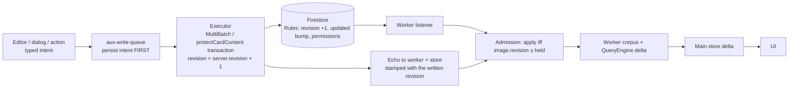
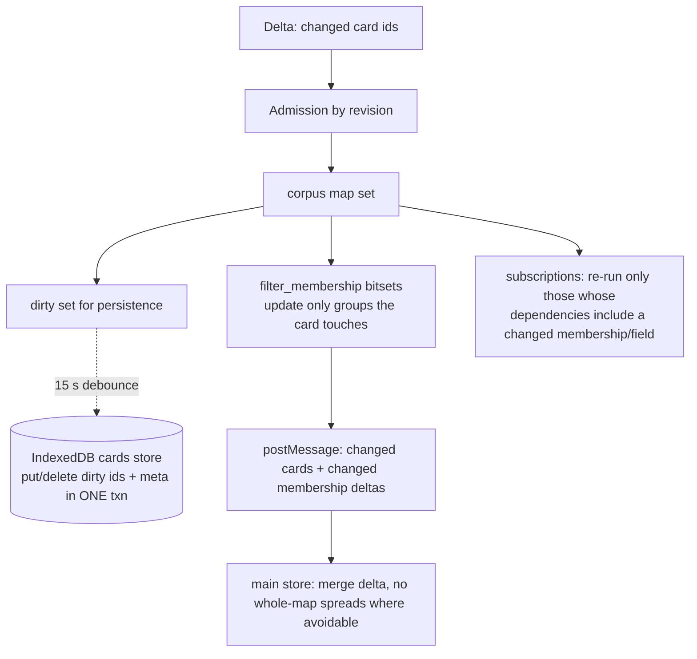

# Lean mutation architecture

Status: DRAFT architecture, 2026-10-11. Owner has heard the pitch and asked to
proceed; not yet adversarially reviewed, not implemented. Detail per slice is
in `docs/lean-architecture/01..04`; where this document and a detail document
disagree, this document is wrong and must be fixed, not the detail.

Baseline: `master` at `8f56ea89`. This replaces the parked server-executor
design on `codex/current-only-integration` (`docs/mutation-protocol/`), which
is not continued.

## 0. The two principles

Everything below follows from two observations about master.

**The system has no notion of "newer".** No version number exists anywhere:
not on the Firestore document, not in the worker, not in the store, not in
the editor. Every layer applies whichever card image arrives last; the only
ordering token is `updated`, a server timestamp the client cannot know until
the round trip completes. The blank card, the parked-save keystroke loss, the
editor hijack and the value-comparison conflict check are the same absence at
four layers. Firestore already serializes writes (transactions + Rules); what
is missing is for that serializer to stamp an order number that clients carry.
`revision`, enforced by Rules, admitted by every holder, gives the whole system
causal order without a server in the loop.

**Work must be proportional to the change, not the corpus.** Each pipeline
stage was written when "recompute from the full map" was cheap: filter maps
are rebuilt as whole copies, subscriptions re-run over all cards, persistence
rewrites all cards. At 47k these are one violated invariant — *every stage
consumes a delta and produces a delta* — at three stages, not three bugs.

## 1. Goals, restated as testable targets

From the owner's acceptance criteria (parked handoff §"User-visible destination
and acceptance criteria"):

| # | Target | How it is judged |
|---|---|---|
| 1 | Save→New repeated for an hour at ≥47k cards stays responsive; no whole-corpus work per save; no background work that accumulates | Matched A/B journey (§6, slice 0), signed in, worker on: worker+main CPU per cycle, cycle N vs cycle 1, after reload |
| 2 | Single Save writes exactly what was authored, including deliberate clears; typing during an in-flight save survives; pending/failed work stays visible | Behavioral tests on the real editor thunks (`test/` harness that mounts real components); vacuity-proven |
| 3 | Multi-edit accounts for every selected target; partial outcomes are named, not hidden; not slower than today | Existing durable multi-edit tests plus per-target result surfacing; perf gate on the 6/30-target apply |
| 4 | A saved card never renders blank, in drawer or full view | Revision admission tests with delayed/reordered images; browser test with a throttled worker forward |
| 5 | Drawer up/down pays no new per-card or whole-corpus work | 20 Down / 20 Up in the matched journey; worker task count per navigation |
| 6 | Overlapping operations never hijack, blank, or close another card's editor; reload/retry/account switch preserve or refuse work explicitly | Editor-session scoping tests (§4.3) |
| 7 | Generated working-notes titles are viewer-private; the shared authored title is preserved | No write path can put a generated title into `cards/*.title`; test asserts the finisher is gone |
| 8 | One write path, strict boundaries, simple to operate; one-time wipe acceptable | Line budget (§7); no build-fingerprint gates; no second queue; every master journey still works (§4.6 inventory) |

No numeric SLA is invented. The gate is the A/B ratio against master on the
same fixture, plus "no regression" on anything the journey measures.

## 2. Diagnosis (what the research established)

> **Measured 2026-10-11 (supersedes the ranking below).** Signed-in, worker
> on, 30k cards, 5 Save→New cycles, snapshot persistence on vs off: worker
> CPU identical (59.4 s vs 59.8 s). The snapshot costs ~1 s per run and is
> NOT the per-edit cost. The CPU profile attributes **7–8 s of worker CPU per
> edit** to `suggestTags → _ensureTagFingerprints`: every tag's combined
> fingerprint was rebuilt after any card change (`_cardsVersion` guard,
> `src/worker/query-engine.ts`). Second: the similar-cards filter
> (`closestOverlappingItems`, ~4 s per cycle). Third: a 60 s+ worker stall on
> the first edit after boot, which is the per-card fingerprints being cold.
> Slice P1 (commit `933ba32c`) fixes the first: per-edit 1.8–3.0 s → 0.1–0.3 s
> at 47k **synthetic**. Emulator *latency* numbers at scale are artifacts
> (the emulator re-sends corpus-sized payloads per write); CPU call stacks
> are not. The 47k synthetic corpus also OOMs the renderer 3/3 times, and
> the owner confirms production OOMs at 47k; that investigation is separate.
>
> **Correction, same day, on the real DEV corpus** (40,229 cards, 285
> concepts, 354-char average body, 0.37 tags/card, 52 tags — versus the
> synthetic 2,809 concepts, 2 KB bodies, 3.8 tags/card): the tag-fingerprint
> path costs ~0.25 s per edit on master, not 7–8 s. The synthetic corpus
> exaggerates NLP and tag costs ~30×. P1/P2 remain correct and worthwhile
> (untagged edits → 0 ms; cold fingerprint build 11.3 s → 4.7 s) but do not
> explain the owner's 5–20 s per card. **Hotspot ranking must come from a
> profile on the DEV export.** Do not benchmark against `gen-corpus.js` for
> ranking.
>
> **Real-corpus profile (40,229 DEV cards, signed in, warm, per Save→New
> cycle, master):** worker 5.4 s, main 1.9 s, plus ~8 s/cycle of renderer
> CPU on threads other than main/worker (unattributed; likely GC/compile
> helpers). Worker: collection re-runs 48% (~2.6 s; the similar-cards
> fallback 41%, re-scanning 40k per key change; ~46 runs per cycle because
> every editing-card mirror dirtied every subscription), enumerating all
> cards through the lazy processing Proxy 18% (NOT the similar filter's
> `fingerprints()` rebuild, which measures ~95 ms warm — the enumerating
> caller is still unattributed), snapshot save ~16%
> (~0.85 s), GC 11%, Firestore SDK ~15%, tag fingerprints 5.6%. Main:
> `diffCards` 18%, `makeFilterFromCards` 13%, `makeEverythingSetFromCards`
> 8%, `cardsThatWillBeRemoved` 7%, Proxy enumeration. Cold first edit: one
> 5.6 s worker task on master, 2.6 s with P1+P2.
>
> **Memory (heap investigation):** the renderer's ~4 GB V8 budget is shared
> by main thread and worker; at 47k synthetic they sit at ~3.2 GB before any
> transient. Top worker retainers: memoized `wordCountsForSemantics`
> dictionaries (31%; removed in P4a, 186–361 MB on the real corpus),
> processed cards (~500 MB), raw cards incl. `nlp_search_tokens` (~440 MB),
> search index (~170 MB). Crash triggers are transients on top: the Firestore
> SDK's persistent-cache full-collection decode on **every** new listen
> (~37 KB/doc ⇒ ~1.75 GB at 47k synthetic; prod docs are ~40–60% that size)
> and the first-edit fingerprint pass. The main thread holds a second full
> set of processed cards (~510 MB).
>
> Landed on this branch: P1 `933ba32c`, P2 `a1f5ae56`, P3a `c3002587`
> (allocation-free `semanticOverlap`, 280→116 ms per 40k scan), P3b
> `fa2b11d4` (`'editing'` dirty scope), P4a `800b7f77` (word-count memo
> removed).

Verified by reading or by synthetic measurement at 47k cards, unless marked.

| Symptom | Mechanism on master | Evidence | Status |
|---|---|---|---|
| CPU per new card | **(a)** `collectionReducer` UPDATE_CARDS copies every whole-corpus filter map whose membership changed: ~325 ms, and it runs **twice** (main thread `src/reducers/collection.ts:144`, and inside the worker via `QueryEngine.updateCards` `src/worker/query-engine.ts:288`). **(b)** Every live subscription re-runs `runCollection` over the whole corpus after a 50 ms debounce: ~200–300 ms for four plain subscriptions, more for semantic ones. **(c)** ~15 s after any mutation the worker walks all cards (`toWire`) and `put`s one giant record to IndexedDB (`src/worker/corpus-worker.ts:651-787`, `corpus-snapshot.ts`); up to three abandon/restart cycles under churn. **(d)** Main-thread O(N) spreads per dispatch (`cards`, `slugIndex`, `cardMeta`, `diffCards`): ~75 ms. | (a),(b),(d) measured synthetically; (c) code-verified, cost estimated 2–8 s | (c) being measured live (slice 0) |
| Blank card after save | No layer orders card images. Main reducer is `{...state.cards, ...action.cards}` (`src/reducers/data.ts:217`); worker `updateLocalState` has no guard and its own comment admits a page can roll a card backward (`corpus-worker.ts:877-907`). A late older listener image (for a new card: the blank create image) overwrites the newer echo. Secondary: `EDITING_FINISH` and any `MODIFY_CARD_FAILURE` clear the optimistic face for *whichever* card is pending (`reducers/editor.ts:174,183`). | Code-verified | Confirming browser repro is slice 1's first test |
| Lost in-flight edits | A second single save **parks** behind a running one *before* its intent is persisted (`src/actions/data.ts:1100-1123`); the editor stays open with no scrim, keystrokes continue, then the diff computed at commit time is written and the draft with the extra keystrokes is deleted on success. | Code-verified | |
| Editor hijack | The post-park `editingFinish(true)` checks `selectIsEditing` but not *which* card (`data.ts:1162`); a parked save for A can close B's editor and write A's cancelled edit. | Code-verified | |
| Slow echo (2–13 s at 50k, branch's trace) | Between commit and the worker receiving the doc: SDK persistent-cache write, view computation for every matching listener including the 47k published full-set query, and worker-queue contention. Cause unattributed. | UNVERIFIED | Slice 0 measures listener delivery |
| Missed multi-edit targets | Largely fixed on master already (`0c2f15f9`, `d11b5f4c`, `a2fe204e`: per-target accounting, markers, resume). Gaps: `modifyCardsIndividually` (suggestions) is not durable; the counts are not surfaced to the user. | Code-verified | |
| Private titles | `workingNotesExtractor` (`src/card_finishers.ts:31-45`) bakes a fingerprint of the **saver's** visible corpus into the shared `title` on every create/save. Working-notes cards have no authored title on master. | Code-verified | |

What the parked branch got right and we keep: the client-side membership
bitsets (`shared/filter_membership.ts`), incremental selector deltas, the
idea of a monotonic revision with admission, the private-title algorithm as a
pure kernel. What it got wrong and we drop: a per-save server executor, a
second queue, build-fingerprint gating, a Rules fence that breaks stars and
comments, multi-profile/cutover/census tooling.

## 3. Principles

1. **Firestore Rules are the authority. Clients write directly.** No server
   round trip on the save path. A Cloud Function is used only where a
   multi-document invariant cannot be expressed in Rules *and* the one-writer
   deployment does not already make the race unreachable (§4.5).
2. **Order by revision, not by arrival.** Every card carries an integer
   `revision`. Rules enforce `+1` on content writes. Every layer that holds a
   card image (worker corpus, main-thread store, editor base) refuses an image
   with a lower revision than the one it holds.
3. **One durable queue.** `src/aux-write-queue.ts` is the queue. Everything
   that must survive reload is an intent in it, including single saves and
   multi-edits. Nothing else persists write intent.
4. **Per-mutation work is O(changed cards), never O(corpus).** Membership,
   persistence, selectors and subscriptions update from a delta.
5. **Generated data is derived, never stored in shared documents.** The
   generated working-notes title is a display projection from the viewer's own
   corpus.
6. **One-time cutover, no compatibility layer.** The ~3 clients wipe site data
   and sign in again. Server data gets one idempotent script run.

## 4. The architecture

### 4.1 Write path

- **Intent before anything else.** `modifyCard`, multi-edit, bulk-tag,
  create, delete, reorder, slug, tag-create, resolve-thread and
  suggestion-apply all become aux-queue intents. The intent is persisted
  *before* the editor closes and before any wait; from that moment the user's
  keystrokes are a new draft against the next base, never part of a save in
  flight. The single-save record on master is a one-slot localStorage key
  (`data.ts:1033-1036`), which is *why* a second save parks before persisting;
  so `card-modify` becomes a queue kind in slice 2, not slice 6. A `cardLane`
  (in-tab promise chain + Web Lock) serializes card-writing executors; the
  wait on the lane *is* the old park, but it happens after persistence.
  Detail: `02-editor-session-and-queue.md` §1.4, §3.
- **Executor keeps today's transaction.** `MultiBatch.protectCardContent`
  already re-reads the card in a transaction and compares values
  (`src/multi_batch.ts:142-170`). `MultiBatchBase` — the one place every card
  write passes through, including `tools/mount.ts` — injects
  `revision: increment(1)` once per card per Firestore batch. `increment(1)`
  satisfies the `+1` rule with no read, on legacy cards and inside the
  transaction (emulator-verified). Value comparison stays the conflict policy
  (it lets non-overlapping concurrent edits merge); revision is the *ordering*
  token, not the conflict token. Detail: `01-revision-and-admission.md` §2.
- **Echo carries the revision.** After commit the executor echoes the written
  card with its new revision to the worker and the store. The later listener
  image has the same revision and is accepted as a refresh; a stale image has
  a lower revision and is dropped. The blank-card race is closed at every
  layer, not patched in one. Slice 1 keeps today's post-commit re-read echo;
  a zero-read echo from the transaction snapshot is a follow-up once slice 0
  attributes echo latency.
- **Multi-edit stays as it is** (chunks, markers, resume, per-target
  accounting), re-homed as `multi-edit` and `bulk-tag` intent kinds with an
  immutable payload key and a small mutable progress key (today each chunk
  re-serializes the whole record: ~30 s over a 60k-target run). Detail: `02`
  §3.2.

### 4.2 Revision and Rules

- `cards/{id}.revision: number`. Missing is read as `0` (legacy cards need no
  backfill).
- Rules, card `update`: a new `cardContentUpdate()` = `bumpsUpdated() &&
  (revision == get('revision',0)+1 || affectedKeys ⊆ inbound-mirror keys)`.
  `cardEditMinor` and `cardEditInboundReferences` need no text change: each
  already ends in `affectedKeys().hasOnly([...])` without `revision`, so a
  bump falls through to the content clause. Create requires `revision == 1`.
  Rules judge a batch's **final** state, so two increments on one card in one
  batch are +2 and denied — hence "once per card per batch" in `MultiBatchBase`.
  Widening the inbound floor instead blew the 1000-expression budget; the
  inbound exception lives inside the content clause. All 59 prototype cases
  pass; the existing 200-case security suite passes after 12 fixture lines.
- Admission (`shared/card-revision.ts`, zero imports):
  `cardImageMayAdvance(held, incoming)` accepts iff
  `incoming.revision >= held.revision`; equal is accepted so counter-only
  updates and the listener refresh of an echo apply. Removals/tombstones are
  not judged. Called from worker `updateLocalState` (which now *returns* the
  admitted map and every `forwardBatch` forwards that), main `receiveCards`
  (before the `awaitingServerTimestampIDs` check), the `UPDATE_CARDS` reducer
  as a backstop, and the editor's `EDITING_UPDATE_UNDERLYING_CARD`.
  Pending-write images (`hasPendingWrites`) must not raise the floor.
- Detail, rule text, writer table and tests: `01-revision-and-admission.md`.

### 4.3 Editor session

- An editor session is `{cardID, generation}`; every continuation that
  resumes after an await, modal, timer or round trip carries it (or the
  operation id) and is ignored when stale. Synchronous teardowns (ownership
  purge, delete) stay unconditional. `pendingSaveCard` (one slot for all
  cards) becomes `pendingSaves` keyed by card; `EDITING_FINISH` never clears
  it; `MODIFY_CARD_SUCCESS/FAILURE` carry an operation id and touch only
  their cards; refusals stop dispatching `MODIFY_CARD_FAILURE` and use a
  snackbar.
- The commit diff is computed against the editor's own base
  (`underlyingCardSnapshot`), not the corpus copy; `baseFields` for the
  overwrite guard are recorded from that base too.
- Reopening a card whose save is unacknowledged is allowed: base =
  committed card, Save disabled with a visible reason; on ack the base
  advances and only new keystrokes remain dirty.
- Save eligibility: one selector (`selectEditorSaveEligibility`) combining
  dirty-vs-base, corpus status and "no unacknowledged intent for this card",
  returning a reason; used by the button, Cmd-Enter, the perf harness, and
  the thunk itself. Non-editor writers keep `selectCardSavesEligible`.
- `editingCommit` holds three `confirm()`s; house style requires replacing
  them when the function is edited — slice 2a, a pre-save review dialog.
- Drafts: the queue holds committed edits; the draft slot holds uncommitted
  ones. The stamp/preserve/confirm draft machinery goes away.
- Detail, reducer rules and ten behavioral tests: `02-editor-session-and-queue.md`.

### 4.4 Worker and main-thread update path

- **Membership.** Port five branch commits (`85b4297c`, `2d5e20dc`,
  `2c86553a`, `60a2429a`, `38fd5f99` minus viewer-graph/manifest parts):
  `shared/filter_membership.ts` bitsets, collection reducer, incremental
  selector deltas. Four apply cleanly; the branch's own type-aware guard
  confirms no further consumer. No protocol imports. Three corrections to
  the branch: keep master's card-major prime fast path (bulk bitset builder);
  hand the prime to the main thread as bitsets instead of 78 plain maps
  (5 ms wire + 105 ms build vs ~950 ms clone — a boot *win*); replace the AVL
  id index with a lineage-shared `Map` (lookup 8× faster, and it sits inside
  every collection run). Do **not** port `ViewerReferenceGraph` or the
  per-save graph-view spread.
- **Persistence.** IndexedDB v1→v2: stores `cards` keyed `[scope, cardID]`
  and `meta` (per-scope cursors/clamp/sections/tags + owner record).
  `updateLocalState` adds to a dirty set; flush captures dirty cards
  synchronously and writes puts/deletes/meta in one transaction with the
  owner check. Transaction atomicity replaces the abandon/restart logic. One
  full rewrite per cold boot; never in steady state. Boot is one `getAll`
  range + meta in one readonly transaction. An un-wiped client's upgrade
  drops the old store and rebuilds from Firestore.
- **Subscriptions.** The engine returns an `EngineDelta` (changed filter
  names, card ids, sets, editing). Each subscription records its dependencies
  at subscribe time (filter names incl. viewer-state names, `global` for
  configurable filters/limits/rank sorts). Re-run iff a dependency changed, a
  shown card changed, or a changed card could enter. Reads yield
  `{read}` only; the `markDirty('all')` on `UPDATE_READS` goes away.
- **Drawer.** Card-view reference blocks miss their main-thread memo whenever
  `filters.read` changes (every auto-read), so each block re-runs a worker
  `runCollection`. A 64-entry worker-side LRU keyed by description/card/
  uid/similarity version, evicted by the same dependency rule, makes Up/Down
  revisits and auto-reads zero worker runs.
- **Main thread.** The remaining O(N) spreads (`cards`, `slugIndex`,
  `cardMeta`) are ~75 ms and are a later slice if the journey still shows
  them.
- Detail, benchmarks, schema and tests: `03-worker-update-path.md`.

### 4.5 Multi-document invariants

Concept-name uniqueness, slug uniqueness and tag+start-card creation are
check-then-write on the client today. With one writer, and tabs serialized by
the existing ownership lease, the race requires the same person racing
themselves across the lease boundary. Decision: **keep them client-side**,
make each durable (intent kinds), and keep the existing `legal` slug callable
as the server-side check it already is. No new Cloud Functions. The owner may
override this (§8); if so, the only functions added are a `reserveSlug` and a
`createTag` transaction, each ≤100 lines, and nothing else moves server-side.

### 4.6 Journey inventory (must all keep working)

Editor save; create (working notes, section, fork, generated concept/person/
work from drawer and find dialog); bulk import; multi-edit with tags,
priority, published, references, TODO; tag create; reorder; delete; slug;
stars; reads; reading lists; comments and threads incl. resolve; permissions
on a card; admin permissions collection; suggestions apply; user prefs;
maintenance tasks; chat publish. Rows that are non-durable today (reorder,
slug, tag create, resolve thread, suggestion modifications) become durable;
no row is removed or gated.

### 4.7 Private working-notes titles

This slice is a **privacy** fix, not a performance one: in worker mode the
finisher costs ~1–5 ms per save (worker-off rebuilds IDF per save, ~17 s at
47k, which the removal also ends).

- Remove `'working-notes'` from the editing finishers; nothing writes a
  generated title to `cards/*.title` again. Make `title` legal and *optional*
  for working-notes (new `optionalForCardTypes`; three readers assume legal ⇒
  required). The editor shows the raw title with an "Optional title"
  placeholder and must never prefill the display title.
- Display: `displayTitle(card, rawCards, inputs)` = authored title if
  non-empty, else `date + first 8 fingerprint terms` from the **viewer's**
  IDF/concepts/synonyms, memoized on the card *object* (incremental reducers
  preserve identity of unchanged cards). Date = `updated_substantive ??
  created` — not `updated`, which the cutover script and inbound-link writes
  both bump. The drawer window is 250 rows (~310–370 ms cold at 47k), so the
  thumbnail list computes under an 8 ms per-render budget and shows the date
  alone until the rest fill. Worker-side computation only if the browser
  shows p95 > 3 ms per card.
- Making `title` non-derived changes `nlpSourceFingerprintForCard` for every
  working-notes card, so the cutover script must rewrite
  `nlp_source_fingerprint` or every note falls to the slow processing path.
- The branch's kernel is not standalone (four absent modules + parse5); make
  master's own extractor the pure function. The branch's preference/lease/
  coordinator machinery is not ported.
- Cutover script clears titles matching the extractor's date prefix, reports
  any other as ambiguous. Owner decision §8.
- Detail, consumer table, privacy test: `04-private-titles-and-cutover.md`.

### 4.8 Cutover

Rules-first is wrong: the new rule denies content saves from any client that
does not write `revision`, i.e. every un-refreshed client. Master's rules
have no field allowlist, so a new client writing `revision` against old rules
is fine. Therefore **quiesce, then deploy everything together**:

1. Close every app instance on every device (an old client's finisher would
   rewrite titles; an old client does not write `revision`).
2. `npm run backup` (repoints gcloud to prod itself).
3. `npm test`, then `npm run deploy` (rules, indexes, hosting, functions).
4. Run the idempotent script (DEV + dry-run by default; prod needs explicit
   flags): clear generated working-notes titles, rewrite
   `nlp_source_fingerprint`, bump `updated` and `revision` on touched docs.
5. Each of the ~3 clients: clear site data, reopen, sign in, wait for `live`.
6. Verify dated titles in the Working notes tab; a new note has `title == ''`.

Rehearse on DEV first: delete the parked branch's three DEV functions
(`mutationMetadataHost`, `mutationRecoveryOwner`, `mutationRecoveryDispatch` —
the last is scheduled every minute), `npm run reset-dev` to a prod-shaped
corpus, `npm run deploy:dev`, run steps 4–6, record counts and timings.
Detail: `04` §4.

## 5. Slices (each independently landable, reviewed, vacuity-proven, perf-gated)

| # | Slice | Criteria | Gate |
|---|---|---|---|
| 0 | **Measurement harness**: signed-in 47k journey (5× Save→New with 20 s gaps, 20 Down/20 Up), worker CPU profile. Absolute CPU and listener-delivery timing must come from DEV (real Firestore); emulator latency at scale is an artifact. Baselines in a **tracked** path (`test/perf-harness/baselines/` is gitignored). | 1, 5 | Exists and runs; numbers published |
| P1 | **Per-tag fingerprint cache** (`933ba32c`): recompute only tags whose `cards` list a changed card; keyed on `tag.cards` contents because the worker receives the full tag map as fresh objects on every snapshot | 1 | Done: 47k per-edit 1.8–3.0 s → 0.1–0.3 s; 7 tests, 5 vacuity-proven |
| P2 | **Cold-start warm-up**: build per-card and per-tag fingerprints in idle slices after `live`, so the first edit does not stall the worker for 60 s+; bounded by the OOM investigation (memory of retained processed cards) | 1 | First-edit `suggestTags` latency at 47k |
| P3 | **Similar-cards filter** (`closestOverlappingItems`, ~4 s per cycle) | 1, 5 | Per-cycle worker CPU |
| P4 | **Memory at 47k**: top retainers from the heap investigation; production OOMs confirmed by the owner | 1 | Heap at live ≤ budget TBD; no OOM in the 47k journey |
| 1 | **Revision + Rules + admission** at worker, store, editor | 4, 6 | 59 rules cases; blank-card repro fails without admission (already shown red/green in scratch) |
| 2a | **Pre-save review dialog** replacing the three `confirm()`s in `editingCommit` (house style) | 8 | Native-modal pin falls by ≥3 |
| 2 | **Editor session + intent-first saves**: `card-modify` queue kind, `cardLane`, session token, per-card pending faces, base-snapshot diff, one eligibility selector, draft simplification | 2, 6 | Ten behavioral tests on real thunks, each with a named master line that makes it fail |
| 3 | **Membership bitsets + incremental selectors** (five branch commits + three corrections) | 1, 5 | Node ratio test at 12k (new-card ≤0.1×, prime ≤1.1×); journey |
| 4 | **Incremental snapshot persistence** | 1 | One change ⇒ 1 put + meta; journey: worker CPU 15–30 s after save ≈ 0; `snapshotRead` ≤1.15× |
| 5 | **Private titles**: finisher removed, display projection, cutover script | 7 | No write path produces a generated title; privacy fixture (viewer B never sees A's unpublished terms) |
| 6 | **Durable coverage**: `multi-edit`/`bulk-tag`/`reorder`/`add-slug`/`create-tag`/`resolve-thread`/`suggestion-modify` kinds; legacy keys deleted; per-target surfacing; honest discard copy | 3, 2 | Reload-mid-queue per kind; each effect exactly once |
| 7 | **Subscription dependency scoping**; reads no longer dirty everything; worker reference-block cache | 1, 5 | 200-delta equivalence battery; journey: ≤1 recompute per auto-read; 0 worker runs on Up revisit |
| 8 | **Cutover** runbook + script; remove parked DEV functions | 8 | Rehearsed on DEV with a restored prod-shaped corpus |

Order after measurement: P1 (done) → P2/P4 (first-edit stall and memory,
which the owner feels directly) → 1–2 (correctness, small; slice 2 in its
~70-line form per the adversarial review: close the editor when a save parks,
gate the post-park close on card id, per-card pending faces) → P3 → 3 → 6
(~80 lines: per-target surfacing, resolve-thread double-decrement, honest
suggestion refusal) → 7 (`reads`/`stars` dirty scopes only) → 5 → 8. Slice 4
(snapshot persistence) is deferred unless DEV measurement shows it. "One
queue" and "reopen while pending" are dropped (owner, 2026-10-11).

## 6. Measurement (slice 0)

`[DETAIL]` — fill from the live A/B currently running on a scratch master
worktree: snapshot persistence on vs off, worker CPU per Save→New cycle,
listener delivery time, drawer navigation worker tasks, machine load recorded.
The harness becomes the acceptance gate for slices 3, 4 and 7, and the
baseline for every later claim.

## 7. Complexity budget

Estimates from the detail documents (product lines; tests separate).

| Slice | Added | Removed | Tests |
|---|---|---|---|
| 0 | ~400 | 0 | — |
| 1 | ~200 + 12 rules | ~25 | ~450 |
| 2a | ~220 | ~70 | ~200 |
| 2 | ~480 | ~230 | ~650 |
| 3 | ~700 | ~150 | ~600 |
| 4 | ~260 | ~230 | ~350 |
| 5 | ~205 (+150 tool) | ~47 | ~450 |
| 6 | ~620 | ~520 | ~800 |
| 7 | ~280 | ~40 | ~400 |
| **Total** | **~3.5k** | **~1.3k** | **~3.9k** |

Against the parked branch's +47k product and +75k test lines.

## 8. Decisions the owner must make

Lead's recommendation in parentheses; detail-document question numbers after.

1. Keep multi-doc uniqueness client-side (§4.5) or add two small
   transactions? (client-side)
2. Clear existing working-notes titles at cutover versus an `authored`
   marker? (clear; `04` Q-4.1)
3. Re-home multi-edit and bulk-tag into the aux queue (slice 6) or leave
   them as exceptions? (re-home; `02` Q4 on side-key vs IndexedDB payload)
4. Conflict policy stays "value comparison, merge non-overlapping edits"?
   (yes)
5. Delete the parked branch's three DEV functions now or after slice 8?
   (now — the dispatcher runs every minute against whatever is on DEV)
6. Slice 2a (pre-save review dialog) before slice 2, or waive house style
   for this diff? (2a first; `02` Q1)
7. Lift the "cannot reopen a card whose save is pending" refusal, with a
   disabled Save and a visible reason? (yes; `02` Q7)
8. Multi-edit denied targets: skip-and-name, or pause the whole operation as
   today? (skip-and-name; `02` Q3)
9. `fake-indexeddb` as a devDependency for persistence tests, or Playwright
   pages? (`fake-indexeddb`; `03` Q2)
10. Gate thresholds for boot: prime ≤1.1× master, `snapshotRead` ≤1.15×?
    (`03` Q5)
11. Display-title date source `updated_substantive ?? created`? Full-card h1
    shows the private title when authored is empty? (`04` Q1, Q2)
12. Off-mode (worker off) pending-write admission in slice 1 or out of
    scope? (`01` Q2)
13. **Worker Firestore cache**: switch the worker to `memoryLocalCache`?
    It removes the per-listen full-cache decode (the largest OOM transient;
    cold sweep 560 s → 80 s in the investigation) at the cost of the SDK's
    persisted cache and resume tokens; warm boot already primes from the
    app's compact snapshot. (recommend: yes, measured on DEV first)
14. Main-thread duplicate processed cards (~510 MB at 47k): keep lazy, or
    stop materializing the full set on the main thread in worker mode?
16. **Fingerprint warm-ups are gated to signed-in sessions** (readers keep
    the lazy build): ~150 MB and ~6 s of idle worker work per boot for the
    similarity map, ~30 MB / ~2 s for tags. Keep the gate, widen it to
    readers, or make the similarity warm-up opt-in? (recommend: keep)
15. **Sign-off on P4a's trade** (`800b7f77`): 165–345 MB less worker heap
    for ~2 s more on the first similar-cards scan per IDF epoch and ~4 s
    more on the post-epoch re-fingerprint (never per keystroke; the review
    corrected the original "no cost" claim). The engine-owned fingerprint
    map (P3c) removes the recurring part. (recommend: accept)

## 9. Risks

- The measured whole-corpus costs are synthetic (Node, loaded machine). Slice 0
  is in place to replace them with browser numbers before slices 3–4 are
  judged.
- The 2–13 s listener delivery delay is unattributed. If it is SDK persistent
  cache cost, the fix is outside this plan (listener shape / cache strategy)
  and gets its own design after slice 0.
- Porting membership bitsets touches wire and selector boundaries
  (`membershipHas` / `membershipToFilterMap`); the branch's boot regression
  shows how easy it is to lose the prime fast path.
- Revision rules reject any writer that does not bump revision; every
  content-write site must go through `MultiBatch` (the raw `runTransaction`/
  `updateDoc` sites in comments, maintenance and chat are counter/non-card or
  must be moved).
